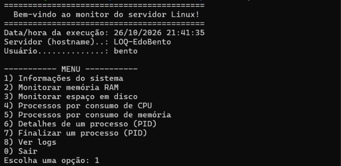
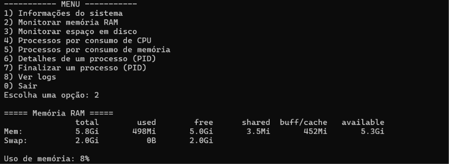
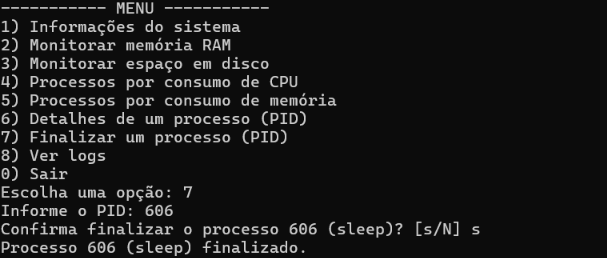
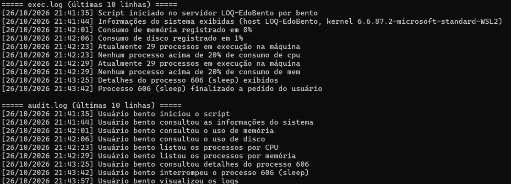

# CP3 – Linux | Operating Systems

Script em Bash para monitoramento e administração de um servidor Linux: exibe informações do sistema, monitora RAM, disco e processos, permite consultar e finalizar processos por PID e registra todas as operações em log.

## Integrantes

| Nome | RM |
|------|----|
| Ricardo Di Tilia | RM555155 |
| Bento Rangel | RM559124 |
| Eric Yuji | RM554869 |
| Kaue Pires | RM554403 |
| Higor Batista | RM558907 |

## Estrutura

```
.
├── script.sh              # script principal
├── CP3_Shell_Script.docx  # enunciado com os nomes do grupo
├── docs/                  # prints da execução
└── README.md
```

Os arquivos `exec.log` e `audit.log` são criados no diretório onde o script é executado.

## Como executar

Requisitos: Linux com Bash e os utilitários padrão (`ps`, `free`, `df`, `awk`).

```bash
chmod +x script.sh
./script.sh
```

Para que a trava de memória e a opção de finalizar processos alcancem processos de outros usuários, execute com `sudo`.

## Funcionalidades

Ao iniciar, o script exibe uma mensagem de boas-vindas com data/hora, hostname e usuário (armazenados em variáveis) e abre o menu:

| Opção | Ação |
|-------|------|
| 1 | Informações do sistema (SO, kernel, arquitetura, uptime, CPUs) |
| 2 | Uso de memória RAM |
| 3 | Uso de espaço em disco |
| 4 | Top 10 processos por consumo de CPU |
| 5 | Top 10 processos por consumo de memória |
| 6 | Detalhes de um processo informado pelo PID |
| 7 | Finalizar um processo informado pelo PID (com confirmação) |
| 8 | Ver as últimas linhas dos logs |
| 0 | Sair (Ctrl+C também encerra e registra no log) |

### Trava de segurança da memória

Ao iniciar e após cada opção do menu, o script verifica o uso de RAM. Se atingir **75%**, finaliza os processos de **usuários** (UID ≥ 1000) que mais consomem memória até o uso voltar ao normal. Processos do sistema, o próprio script e o shell que o chamou não são afetados.

## Logs

| Função | Arquivo | Conteúdo |
|--------|---------|----------|
| `log_exec` | `exec.log` | Resultados da execução (consumo de memória/disco, processos, trava) |
| `log_audit` | `audit.log` | Ações do usuário (início, consultas, PIDs informados, processos finalizados) |
| `show` | tela | Exibe os dados ao usuário, já que o log não aparece na tela |

Exemplo de `exec.log`:

```
[26/10/2026 20:39:41] Consumo de memória registrado em 7%
[26/10/2026 20:39:41] Consumo de disco registrado em 1%
[26/10/2026 20:39:42] Atualmente 73 processos em execução na máquina
[26/10/2026 20:39:42] Nenhum processo acima de 20% de consumo de mem
```

Exemplo de `audit.log`:

```
[26/10/2026 20:40:24] Usuário bento iniciou o script
[26/10/2026 20:40:24] Usuário bento consultou detalhes do processo 439
[26/10/2026 20:40:24] Usuário bento interrompeu o processo 439 (sleep)
```

## Execução

Testado no Ubuntu (WSL2).

**Boas-vindas e menu**



**Monitoramento de memória**



**Finalizando um processo pelo PID**



**Logs gerados (`exec.log` e `audit.log`)**


